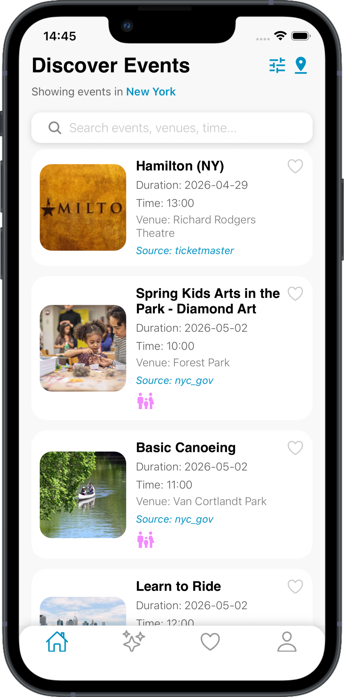
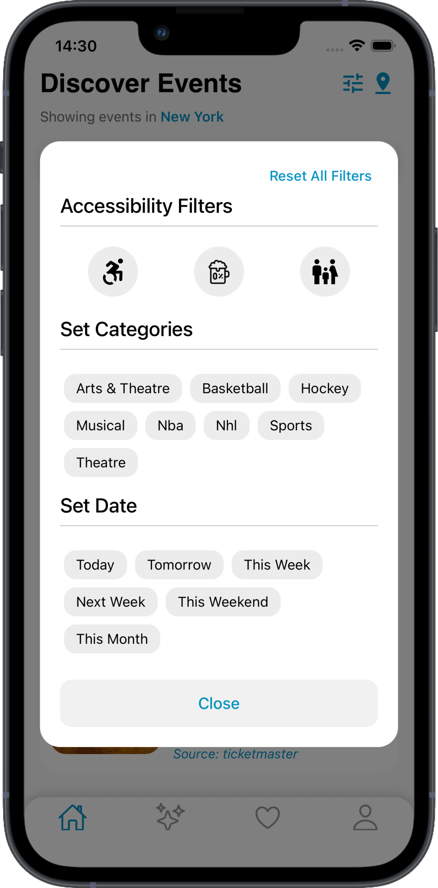
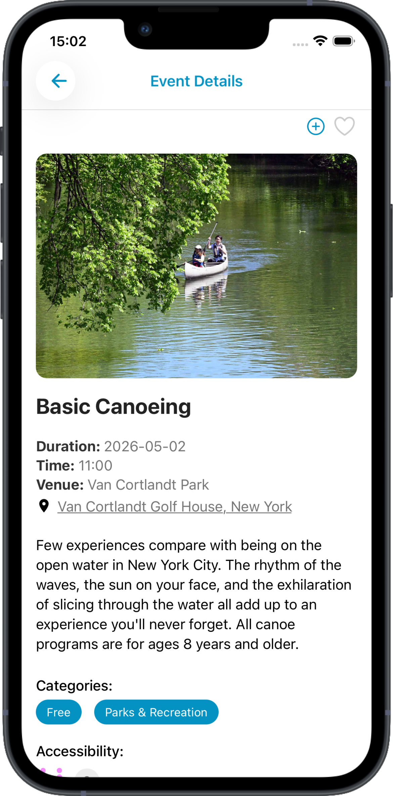
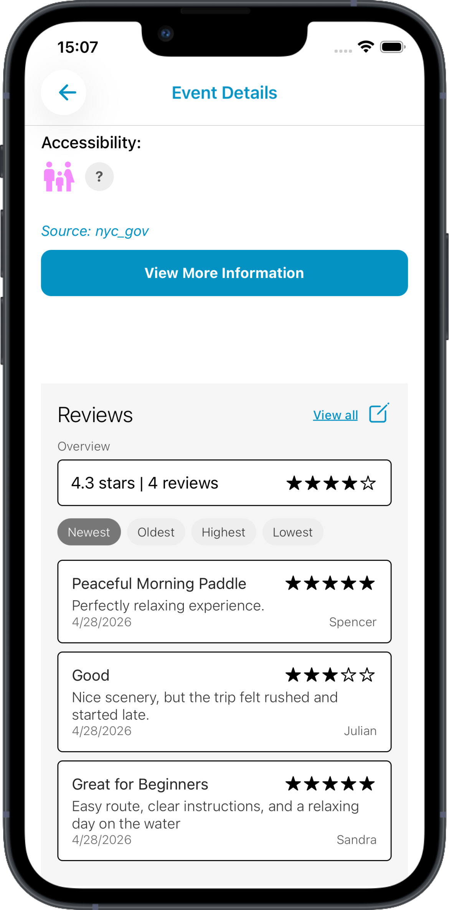
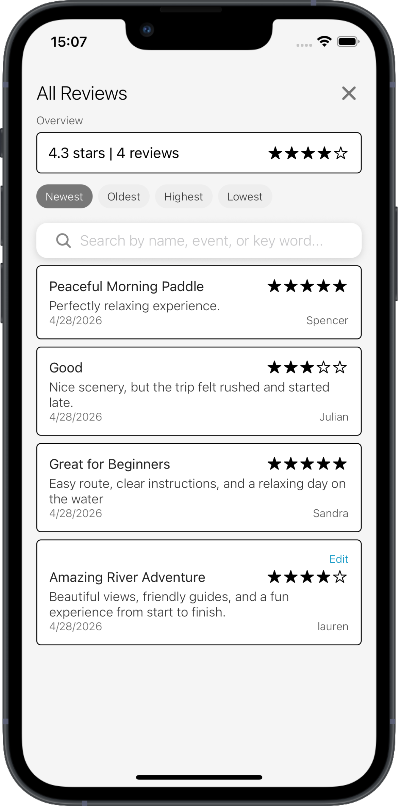
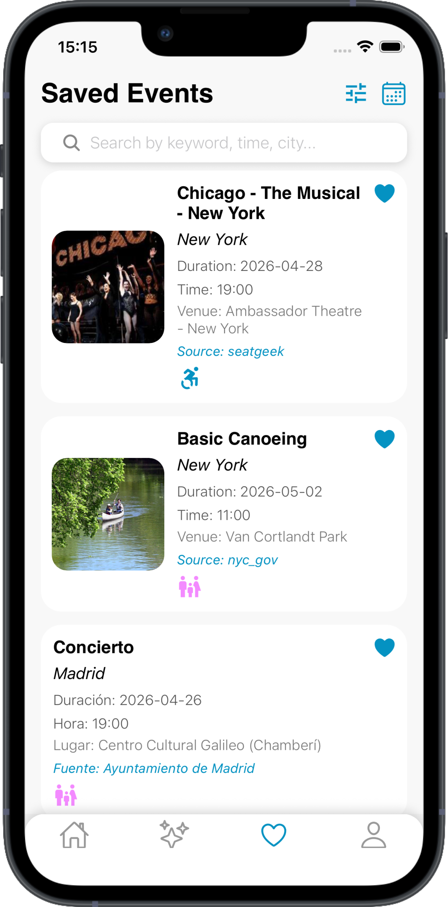
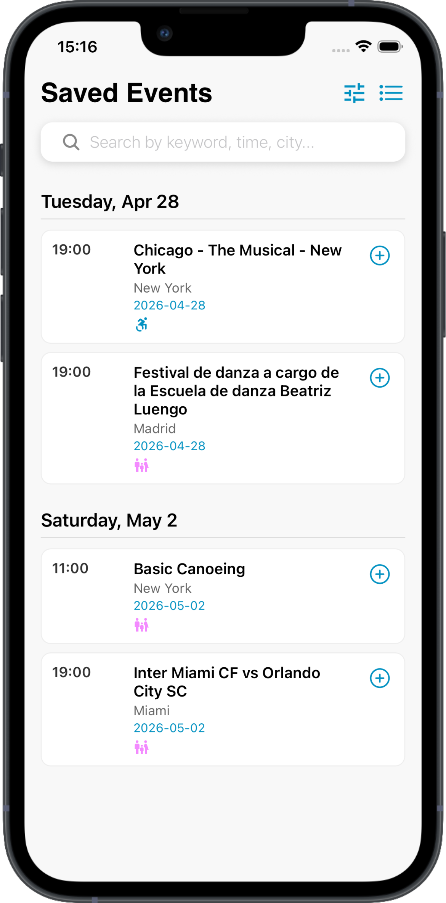
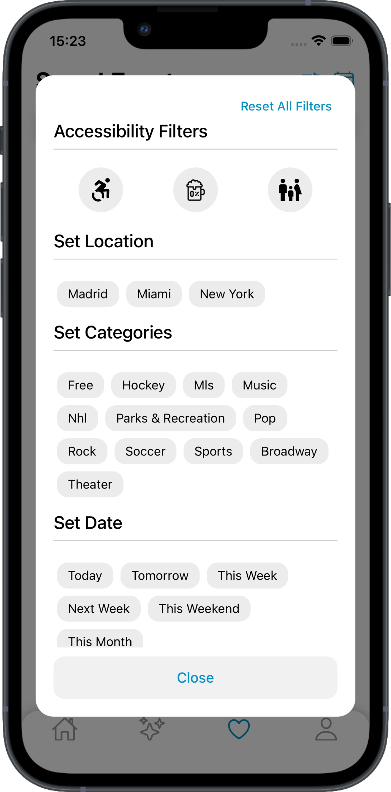
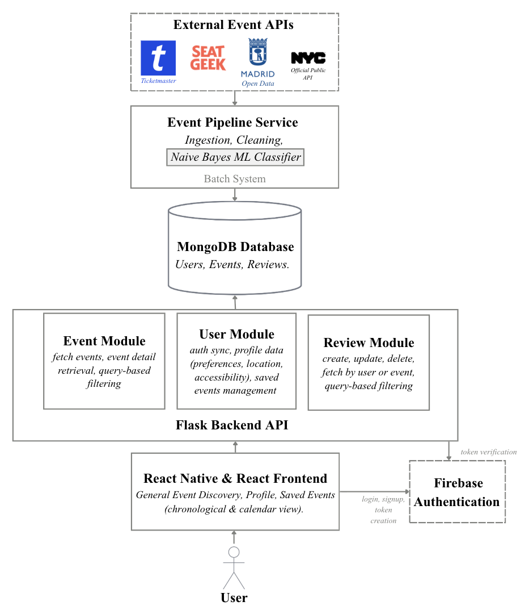

# Evntly!
An event discovery and scheduling application that aggregates event data from multiple external sources and provides search, filtering, accessibility classification, and event management features.
 
---

## Technology Stack
| Technology |  |
|------------|---------|
|  | Frontend user interface and client-side interactions |
|  | Backend REST API and server-side application logic |
|  | Persistent storage for events, users, reviews, and saved events |
|  | User authentication and account management |
|  | Backend development and machine learning components | 

---

## Key Features
- Aggregates event data from multiple APIs across European and North American cities
- Browse upcoming events
- Full-text search over event metadata (titles, descriptions, venues, time)
- Multi-dimensional filtering across category, city (where applicable), date, and accessibility labels
- Unified query system with cumulatively refined results across search and filter inputs
- Machine learning-based accessibility classification using a Naive Bayes model
- Generates wheelchair accessible, family-friendly, and sober-friendly labels 
- Save events 
- Chronological and calendar-based organization of saved events
- External calendar integration
- Event detail pages with ticketing and source links
- User reviews and ratings
---

## Screenshots

### Event Discovery Feed & Filtering Interface

  
  &nbsp;&nbsp;&nbsp;
  

### Event Detail Page & Reviews

  
  
  

---

### Saved Events & Calendar View & Their Filtering Interface

  
  
  

—--

## System Architecture

  

Service-based backend with batch ingestion, ML enrichment, and REST API delivery.

---

## Technical Highlights
- Built a data pipeline integrating event data from 4 external APIs and normalizing it into a unified schema.
- Developed a Naive Bayes classifier to automatically assign accessibility-related metadata to events, enabling more targeted searches.
- Implemented frontend search and multi-criteria filtering by combining user-selected filters into MongoDB queries.
- Designed a modular Flask backend using Blueprints to separate event, user and review management.
- Integrated Firebase Authentication and MongoDB to manage user accounts and persist saved and liked events.

## Future Improvements
- Introduce Redux Toolkit for centralised state management of shared data, such as liked and saved events, reducing the need for prop drilling across pages.
- Develop a web data collection pipeline using permitted web-scraping sources to extract, parse and normalise event data, improving coverage of smaller local and pop-up events.
- Implement a vector-based recommendation system using event and user-interest embeddings to identify and recommend semantically relevant events.
